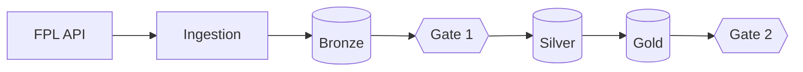

# FPL Data Engineering Project

## About this project

This project is an end-to-end data pipeline for Fantasy Premier League (FPL) data. It pulls live data from the official FPL API, stores it, cleans it, validates it, and prepares it for a dashboard.

I built this as a portfolio project to demonstrate real Data Engineering skills: pipeline design, data quality checks, orchestration, containerization, and proper database structuring—not just writing queries on top of existing data.

## Tech Stack

- **PostgreSQL** - Main database (Bronze, Silver, Gold layers)
- **Python (psycopg v3)** - Ingestion, quality check, and transformation scripts
- **Apache Airflow** - Orchestration and scheduling
- **Docker & Docker Compose** - Containerization and local environment setup
- **Azure** - Cloud deployment (Documented)
- **DBeaver** - Database client

## Architecture

I use a Medallion Architecture: Bronze, Silver, Gold.

- **Bronze**: Raw data, exactly as it comes from the FPL API. Stored as JSONB, with no changes. This keeps a safe, unmodified copy in case anything downstream needs to be reprocessed.
- **Silver**: Cleaned and typed data. Fields are extracted from the raw JSON, converted to the right types, and standardized (for example, player price is converted from a raw integer into a real decimal value).
- **Gold**: Final tables, ready for a dashboard. Some tables are denormalized on purpose, so dashboard queries stay fast and simple.

A `pipeline_runs` table tracks every ingestion attempt, not just the final result. If something fails, I can see exactly when it failed and why, on the same day, instead of finding out later.

## Database Design

17 tables in total: 6 Bronze (5 data tables + `pipeline_runs`), 5 Silver, 5 Gold, and `quality_check_results`. Every table and column has a reason behind it, documented directly in the SQL files—why some tables are denormalized and others are not, why some tables carry traceability columns (`load_date`, `source_run_id`) and others don't.

The schema is built around 6 real questions a dashboard needs to answer:

1. Show all midfielders under £8.0m, sorted by total points
2. Find the best points-per-price value
3. Show how a player's price changed over time
4. Show the most transferred-in players this gameweek
5. Compare a player's actual points with their expected points (xG/xA)
6. Show which players are injured or doubtful right now

## Data Quality

Two checkpoints ("gates") protect the data, and every result is saved in the `quality_check_results` table (including the list of failed IDs as JSONB, not just a count):

- **Gate 1 (Bronze)**: table constraints cannot look inside raw JSON, so Python checks run on the JSONB itself (for example: required keys missing, invalid player status, finished match without scores). The Silver transformation then **skips** the flagged rows instead of failing the whole run.
- **Gate 2 (Silver to Gold)**: compares row counts between Silver and Gold, so rows that silently disappear (for example from a bad JOIN) are caught. It checks counts only - it does not catch wrong values.



## Orchestration & Containerization

I use **Apache Airflow** to orchestrate the pipeline and **Docker Compose** to run the entire stack locally.

- `Dockerfile`: I use the Python 3.11 version of the official Airflow image. I switched to 3.11 because the `psycopg` v3 library requires Python 3.9 or newer. Running `pip install` as the `airflow` user ensures packages are installed in the correct local site-packages directory.
- `docker-compose.yml`: I use YAML anchors (`x-airflow-common`) to define the base configuration once, preventing repetition across the webserver, scheduler, and init containers.
- `fpl_pipeline_dag.py`: The DAG enforces strict execution order, because of Foreign Key constraints. For example, `transform_teams` must finish before `transform_players` and `transform_fixtures` (Silver), and `populate_gold_players` must finish before `populate_gold_player_gameweek_performance` and `populate_gold_player_price_history` (Gold). Only one DAG run can be active at a time (`max_active_runs=1`).
- **Failures are visible**: an ingestion script that fails records the error in `pipeline_runs` **and** exits with code 1, so the Airflow task turns red. Gate 2 also fails the task when Gold has fewer rows than Silver.
- **Database Initialization**: The `init-db.sh` script automatically creates the Airflow metadata database and executes all my Bronze, Silver, and Gold SQL files in the exact dependency order on the first startup.

## Cloud Deployment (Azure)

The pipeline runs locally via Docker Compose. I also wrote the deployment plan for Microsoft Azure. **It is documented, not deployed yet.**

See the full step-by-step guide in [`docs/azure_deployment.md`](docs/azure_deployment.md).

## Security Settings

How `docker-compose.yml` handles ports and secrets (the first two points keep a server closed to the internet; the third needs my own values on a server):

- **Ports are bound to `127.0.0.1`** (Postgres and the Airflow UI). Only the machine itself can reach them. On a remote server they are reached through an SSH tunnel (DBeaver has an SSH tab; for the UI: `ssh -L 8080:localhost:8080 user@server`).
- **No admin password in the code.** `AIRFLOW_ADMIN_PASSWORD` is read from `.env`. The admin user is created only on a fresh Airflow database, so changing the variable later does not change an existing user's password.
- **`AIRFLOW_FERNET_KEY`** (encrypts stored connections/variables) and **`AIRFLOW_WEBSERVER_SECRET_KEY`** have local-development defaults. On a server I set my own values in `.env`.
- `.env` is never committed.

## Project Structure

```text
sql/
├── gold/dashboard_queries.sql  # one tested query for each of the 6 dashboard questions
├── init-db.sh              # runs all SQL files in dependency order on first startup
├── bronze/                 # Bronze layer table definitions
├── silver/                 # Silver layer table definitions
├── gold/                   # Gold layer table definitions
└── quality_checks/         # quality_check_results table definition

src/
├── db_utils.py             # shared database connection and shared ingestion logic
├── ingestion/              # scripts that pull data from the FPL API into Bronze
├── quality_checks/         # Gate 1 checks (Bronze) + Gate 2 reconciliation (Silver vs Gold)
└── transformation/         # Bronze to Silver to Gold logic

tests/                      # pytest tests (run on temporary schemas built from my real SQL files)

dags/
└── fpl_pipeline_dag.py     # Airflow DAG orchestrating the entire pipeline

docs/
├── schema-design.md        # my Gold schema design notes
└── azure_deployment.md     # Cloud deployment guide

Dockerfile                  # Custom Airflow image with dependencies
docker-compose.yml          # Local multi-container orchestration
.env.example                # Template for local settings (copy to .env)
.gitattributes              # Keeps LF line endings for scripts that run in Linux containers
pytest.ini / requirements-dev.txt   # test setup
```

## How to Run Locally

### Prerequisites

Docker Desktop installed and running.

### Steps

1. Clone the repository.

2. Create your environment file (local development values, never commit `.env`):

```bash
cp .env.example .env
```

   Then make sure `.env` also contains `AIRFLOW_ADMIN_PASSWORD=...` (choose any password). `docker compose` stops with an error message if it is missing, on purpose: there is no default admin password in the code.

3. Start the containers:

```bash
docker compose up -d --build
```

4. Wait for Airflow to initialize. Then, access the Airflow UI at http://localhost:8080 (Username: `admin`, Password: the value of `AIRFLOW_ADMIN_PASSWORD` in your `.env`).

5. In the Airflow UI, turn the `fpl_data_pipeline` DAG **on** (the toggle on the left - DAGs start paused), then trigger it to run the entire pipeline.

To stop everything: `docker compose down`. To also delete the database data and re-run the SQL init scripts from scratch: `docker compose down -v`.

### Connect with DBeaver

| Setting | Value |
|---|---|
| Host | `localhost` |
| Port | `5432` (or `POSTGRES_HOST_PORT` from `.env`) |
| Database | `fpl_db` |
| User / Password | `DB_USER` / `DB_PASSWORD` from `.env` |

Running a script directly from my machine (outside Docker), for example `python -m src.transformation.transform_players`, needs `DB_HOST=localhost` in `.env`.

## Tests

The tests run against a real PostgreSQL, but inside a temporary schema that is created from my own SQL files and dropped afterwards, so they never touch my real data. They check things like: every player flagged by Gate 1 is excluded (not only the first), Gate 1 judges only the newest snapshot, a failed ingestion rolls back and is recorded, and Gold loads do not crash on foreign keys.

```bash
pip install -r requirements-dev.txt
docker compose up -d postgres      # needs DB_HOST=localhost in .env
pytest
```

If the database is not reachable, the database tests are skipped instead of failing.

## Known Limitations

I list these on purpose - they are decisions I understand, not surprises.

- `transfers_in_event` in Silver is the **latest** value from Bronze, not the value at that exact gameweek. It is correct for "most transferred-in this gameweek", but may not match the API for older gameweeks.
- FPL's own team fields (`points`, `played`, `position`, ...) often stay at 0 - this looks like a quirk on FPL's side. None of the 6 dashboard questions use them.
- `player_price_history` is built from the latest Bronze snapshot, and assumes `cost_change_event` resets every gameweek (a reasonable assumption from FPL's naming, not confirmed by official documentation).
- Gate 2 compares row counts only, so it cannot catch wrong values, and it only notices Gold having *fewer* rows than Silver.
- Gate 1 judges the newest snapshot of each player, team and fixture (that is what Silver uses). For `bronze_event` a flagged player is excluded from all gameweeks, not only the broken one.
- Bronze keeps a new full snapshot every day, so it grows continuously. I have not measured the growth yet (`pg_total_relation_size('bronze_players')` after a few weeks will tell), and there is no cleanup of old snapshots.

## Current Progress

- ☑ Full database design (17 tables: 6 Bronze, 5 Silver, 5 Gold, `quality_check_results`)
- ☑ Bronze ingestion for all three FPL API endpoints
- ☑ Dynamic snapshot_type logic
- ☑ Reusable, DRY ingestion functions shared across scripts
- ☑ Gate 1 quality checks for all applicable Bronze tables
- ☑ Silver transformation for all 5 tables
- ☑ Gold population for all 5 tables
- ☑ Gate 2 row-count reconciliation check
- ☑ Docker + Docker Compose
- ☑ Airflow orchestration
- ☑ pytest tests for Gate 1, Silver, Gold, ingestion
- ☑ Dashboard queries for the 6 questions
- ☑ Azure deployment documentation (not deployed)